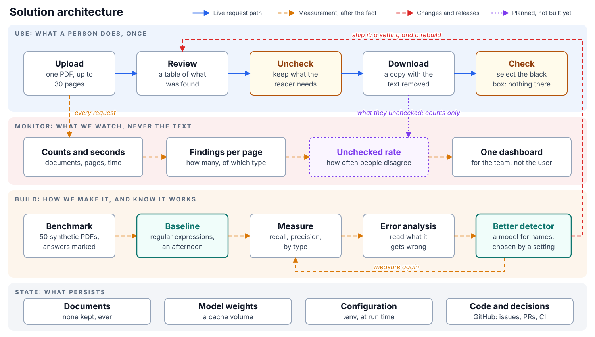
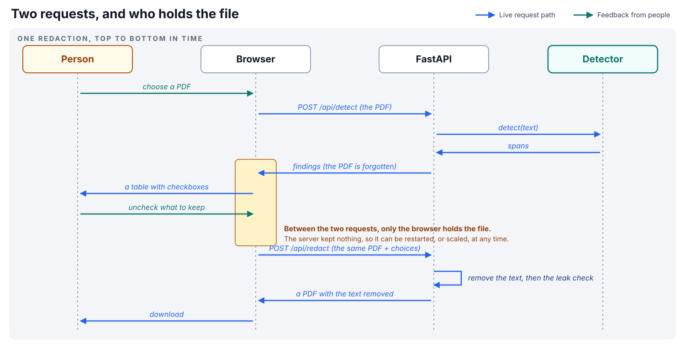
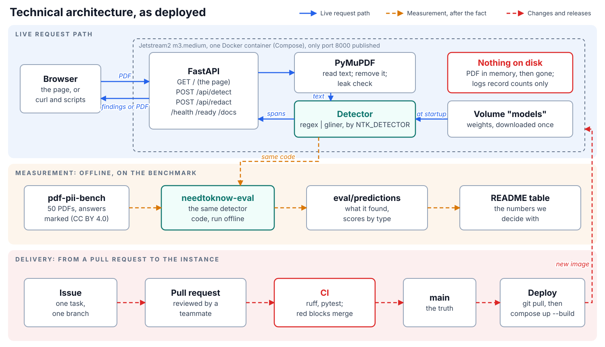
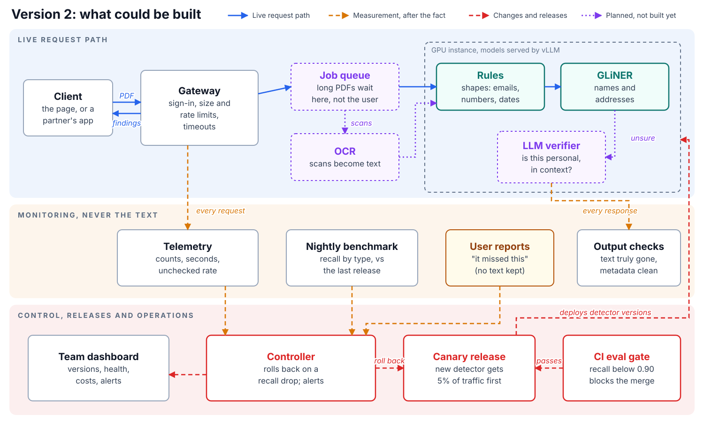

# Need to Know: architecture

*The worked example, in the shape of Final Project Deliverable 2.*

## Solution architecture



| | |
|---|---|
| **Process** | **Build:** gather synthetic documents with known answers (the benchmark), write a baseline detector, measure it, try better ones. **Use:** a person uploads one PDF, sees what was found, unchecks what to keep, downloads the redacted copy, and checks it. **Monitor:** how many documents, how long each took, how many findings, and later how many the user unchecked; never the content. |
| **Execution** | **What the user sees:** one page: choose a file, a table of findings with checkboxes, a download button, a warning to use synthetic documents. **Behind it:** an API with `POST /api/detect` (PDF in, findings out) and `POST /api/redact` (PDF and the chosen findings in, redacted PDF out), plus `/health`, `/ready` and `/docs`. The detector is chosen by a setting; the baseline is regular expressions, the improvement a small transformer. |
| **State** | **Documents:** none kept. Each request reads the PDF in memory and forgets it; the browser holds the file between the two steps. **Models:** the detector's weights, downloaded once into a cache volume. **Configuration:** `.env` at run time (which detector, upload limits). **Source control:** GitHub, one branch per issue, pull requests reviewed before merge, CI on pull requests and on `main`. **Logs:** counts and timings only. |

The decision that shapes everything else: **the document goes to a server.** docscrubber, the app that inspired this one,
runs entirely in the browser so a document never leaves the user's machine, which is the most trustworthy design.
We chose a server because this course is about deploying services, and because a server lets us run models a browser
cannot. That choice makes us responsible for the file: we store nothing, log nothing from it, publish one port, and say
so on the page.



## Technical architecture



The same, as text:

```
 browser ──HTTP──▶ :8000  ┌──────────────────────── Docker container (Compose, Jetstream2 m3.medium) ─┐
 (the page)              │  uvicorn ─▶ FastAPI  needtoknow.api.main                                   │
 curl / scripts          │     GET  /          the page (static HTML + a little JavaScript)            │
                         │     POST /api/detect   PyMuPDF reads text ─▶ detector ─▶ findings (JSON)    │
                         │     POST /api/redact   PyMuPDF removes text ─▶ leak check ─▶ PDF            │
                         │     GET  /health /ready /docs                                                │
                         │  detector, loaded once at startup (NTK_DETECTOR):                            │
                         │     regex (baseline) | presidio | gliner | regex+gliner                      │
                         └──────────────── model cache volume (/home/app/.cache/huggingface) ───────────┘
```

- **Frontend:** a page served by the API itself; no separate frontend app to deploy.
- **API layer:** FastAPI, plain `def` endpoints: the work is CPU-bound (reading a PDF, running a detector), not waiting
  on another service, so async would not help.
- **Model service:** in-process. The model is small, runs on a CPU, and has one caller; a second container would add
  a network hop and nothing else.
- **Storage:** none for documents; a Docker volume for model weights.
- **Deployment:** one image (`Dockerfile`), started with `docker compose up -d` on the team's Jetstream2 instance; only
  port 8000 is published.
- **Monitoring and logging:** structured log lines with counts and timings (planned: request IDs and metrics).

## Where it could go

A vision, not a plan: purple boxes are not built.


